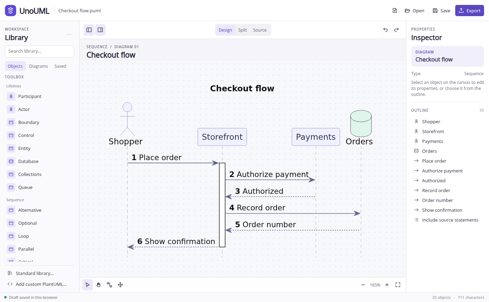

# UnoUML Studio

[Open UnoUML Studio](https://wieslawsoltes.github.io/UnoUML/) · [Download the .NET library](https://wieslawsoltes.github.io/UnoUML/packages/UnoUML.PlantUml.0.5.0.nupkg) · [Build and deployment](https://github.com/wieslawsoltes/UnoUML/actions/workflows/pages.yml)

A visual PlantUML editor for the browser, built with Uno Platform 6.7 and .NET 10 WebAssembly. The file on disk is ordinary PlantUML. The default renderer is a standalone C# library. When a diagram needs additional syntax, the workspace loads the official PlantUML JavaScript renderer and any requested standard-library bundles.



## Working on a diagram

- Open a UTF-8 PlantUML document, start from a template or add another diagram block to the current file. Design, Split and Source share the same edit history. The browser keeps a recovery draft. **Save** downloads the document.
- Click a rendered declaration or message to inspect it. Double-click a supported label or press F2 to edit it on the diagram. Enter commits a single-line label, while Ctrl/Cmd+Enter applies multiline text. Escape cancels and Undo restores the original source. Other statements open in the source editor. The inspector exposes applicable names, colors, class members, endpoints, arrow styles and labels. The outline also lets you reach statements that have no selectable SVG geometry.
- The canvas text editor provides bold, italic, underline, strike and monospace tools. Ctrl/Cmd+B, I and U apply formatting to selected text. Multiline references support Ctrl/Cmd+Enter, formula tools insert fractions, roots, powers and sums, and the Ditaa editor changes complete grids with atomic undo.
- **Select** now moves shapes freely. Drag the eight resize handles or the rotation handle; use **Arrange canvas** for exact bounds, alignment, distribution, matching sizes, stacking, pinning, locking and container collapse. Grid and smart guides assist placement. Geometry is saved in a per-diagram PlantUML comment and participates in the same undo, draft, save and export workflow. [Canvas authoring and architecture](docs/canvas-authoring.md).
- **Arrange → Automatic layout** offers layered flow, tree, radial tree, circle, grid and force-directed placement in four directions. Layout can target a selection while keeping other shapes fixed, and can place new source objects automatically. Pinned and locked objects retain their geometry. Connectors support obstacle routing, manual bends, normalized docking ports and label offsets.
- Salt forms support nested layouts, group boxes, spanning tables, tree tables, tabs, menus, scroll areas and open dropdowns. Double-click a checkbox or radio indicator to toggle it. Select a dropdown heading and use **Choose dropdown value** in the inspector to choose a declared option. Labels, captions and control states share the document's undo history.
- Drag a selected declaration’s connection handle to create an edge. Select an existing edge and drag its source or target handle to reconnect it. The arrow style, multiplicities and label stay in the source. The Move or reorder tool changes directional constraints or compatible source order; free canvas placement is available through Select. Alt-double-click a connector to add a bend; drag its bend or label handles to reshape it.
- Shift-click objects or drag a selection rectangle to select several at once. Copy, cut and paste use PlantUML text. The inspector can group compatible declarations into a package, duplicate a selection or remove it. Structural edits with ambiguous references are restricted.
- DOT nodes support multi-selection, copy/cut/paste, duplication, deletion and grouping into clusters. Ungrouping preserves the nodes and their effective attributes. Node deletion removes incident connections while retaining unrelated chain segments. These edits preserve comments, scoped defaults and line endings and can be undone in one step.
- Shared DOT chains, endpoint products and repeated strict-edge contributions can be normalized into independent statements for individual edge rename, deletion and reconnection. Record fields support insertion, removal, reordering, grouping and port updates. HTML tables support rows, columns, cell insertion, merge and split on both nodes and edges. Port references, scoped defaults, comments and strict-graph invariants are validated before one atomic source edit. [DOT structural authoring](docs/dot-structural-authoring.md).
- Packet fields support insertion, removal, reordering, splitting, explicit ranges and resizing with optional reflow. Charts support series and category restructuring, coordinate points, data labels, colors and secondary axes. Edits validate the complete result and preserve unrelated source. [Packet and chart authoring](docs/structured-authoring.md).
- Pan with the background, Space-drag or trackpad, zoom around the pointer with Ctrl/Cmd-wheel, or pinch on a touch screen. Arrow keys nudge selected shapes; Shift-arrow moves a grid step. Ctrl/Cmd-arrow navigates objects and Enter edits the selection. Alt bypasses snapping; Escape cancels a gesture without changing history.
- Open **Standard library** to search package and include paths. Import local include files, a directory or a ZIP archive from the library menu. `!import` exposes an archive's source, JSON and artwork to C#. Imported text and archive members have their own source editor and support source-mapped canvas edits, undo, redo, apply and cancel. Download a changed file or the complete ZIP. Archive updates retain untouched members, binary assets and ZIP metadata. Save reusable snippets individually or exchange a snippet library as JSON.
- Export the active diagram as SVG or PNG, or open the browser print dialog for PDF. Export uses the same render as the preview and omits editor overlays.

## Renderer coverage

[UnoUML.PlantUml](src/UnoUML.PlantUml/README.md) is a reusable .NET 10 library. It parses a complete diagram, computes its geometry and emits source-mapped SVG. The editor uses the same in-browser C# assembly for preview, picking and export.

| Rendering path | Coverage |
| --- | --- |
| Managed C# | Supported UML and C4 grammars, ArchiMate, Gantt, charts, network, Salt, mind map, WBS, packet, file tree, JSON, block/flow YAML, DOT, Creole, EBNF, regex, Chen ER, Ditaa, AsciiMath and LaTeX |
| Bundled PlantUML 1.2026.9 and Viz.js | Diagram grammar, Graphviz and layout features outside the managed implementation. The bundle is loaded only when needed or explicitly selected. |
| Optional JVM endpoint | Server extensions, advanced syntax and external engines available on the selected JVM installation |

The status bar shows the engine that produced the current preview. **Library → … → Rendering engine** can force the JavaScript implementation or select a CORS-enabled JVM endpoint for a document. The server receives the active page. Imported local include files remain on the device. Opening another file clears the server selection.

Every catalog template and compatible toolbox insertion must render in C# for CI to pass. Coverage is a fixture count. The compatibility engines remain available for more extensive syntax in each dialect. CI also exercises 1,080 partially edited inputs. The library index contains 27,780 include paths. The managed loader resolves 27,783 unique resources through content-hashed chunks with a 128 KiB target. Generated statements retain their invocation and include-file provenance. Native output uses its own layout and font metrics. Native JSON fields can be edited individually even when a document is minified or contains identical values on one line.

## Native compatibility in 0.5

| Area | Added support |
| --- | --- |
| TIM and legacy macros | Defaults, named arguments, overloads, recursion, scoped variables, multi-statement return functions, early returns, procedures, legacy defines and multiline defines, JSON paths and object iteration, dynamic invocation and 74 built-ins. C4 and ArchiMate expansion evaluates effectful calls once, preserving provider and diagnostic order. |
| Resource resolution | Relative includes, diagram selectors and subparts, named definitions, host-provided URLs and archives, JSON resources, bundled themes and standard-library aliases. Expanded C4 Context/Container/Component/Deployment, ArchiMate, Azure, GCP and AWS fixtures render natively. |
| DOT | Scoped defaults, strict edge merging, subgraphs, nested clusters, four rank directions, rank constraints, ports, record fields, HTML tables, common shapes, compound arrows, gradients, images and hyperlinks. Exact source spans identify nodes, labels, ports and literal edges. |
| Themes and styles | All 44 bundled themes are tested on native class and sequence diagrams. Nested selectors, variables, stereotypes, cascade priority, tree ancestry, font metrics, wrapping, padding, margins, gradients, shadows, DPI and deterministic handwritten drawing are supported in the integrated painters. Activity, timing, JSON, YAML and Salt now measure their rich labels and applicable spacing rules before layout. |
| Data and activity grammars | YAML supports nested block and flow collections, quoted keys, comments, literal/folded strings and path highlighting. Indented scalar lines, indentless sequences and tab indentation follow the pinned upstream parser. Anchor-, alias- and tag-looking scalars retain PlantUML's literal-text behavior. JSON shares styled tables and highlights. Activity adds multiline actions, inline colors, rich decision/branch labels and additional action shapes. |
| Salt forms | Recursive grids, group boxes, horizontal spans, separators, tree tables with nested widgets, horizontal/vertical tabs, menus with popups, scrollbars and open dropdowns use measured native layout. Popups paint above the grid and expand the exported image bounds. Escaped pipes and braces remain inside their literal cells. |
| Timing | Robust, concise, rectangle, binary, analog and clock tracks support participant-oriented transitions, exact decimal and relative times, named anchors, clock references, date/hour axes, manual axes and explicit scale. Notes, constraints, highlights, state definitions and styled messages retain source fields. Message endpoints follow binary states and interpolated analog values. |
| Rich text and formulas | Integrated painters support Creole and HTML font styles, links, Unicode escapes and alignment. Inline `<math>` and `<latex>` produce native vector formulas. Standalone formulas add aligned arrays, colors, annotations, accents, braces, cancellation, mathematical alphabets and phantom spacing. |
| Artwork | Custom grayscale and 4096-color sprites, compressed sprites, SVG resources and data-URI PNG/GIF/JPEG/WebP images. The portable library includes 223 OpenIconic glyphs and 1,174 Twemoji images with 1,163 named shortcuts. |
| Source-aware editing | Exact UTF-16 token ranges preserve BOMs and CR/LF line endings. Typed field editing distinguishes repeated JSON/YAML values, Salt widgets, chart values, packet captions and timing literals. YAML block edits retain indentation, explicit indentation indicators, chomping and header comments, including list mappings. Multiline activity-label edits retain indentation, colors and stereotype suffixes. DOT adds node and cluster structural operations to label editing, node/edge insertion and literal-edge reconnection/deletion. Imported-source and ZIP-member edits participate in document undo/redo with conflict detection and persistent browser storage. |
| Structured canvas tools | Rich-text formatting, multiline reference editing, AsciiMath/TeX structural insertion and complete Ditaa grid editing use the existing atomic document history. Salt checkbox/radio states, dropdown values and nested captions support direct editing. Eight additional Salt toolbox tools and the settings-panel template expose the expanded form grammar. |
| Free geometry and layout | C# layout/routing models persist positions, dimensions, rotation, compound parents, locks/pins, stacking, collapse, docking ports, bends and label offsets. The browser projects those values onto semantic SVG and exports the edited geometry. Six deterministic placement algorithms, selection scopes, incremental insertion, alignment, equal gaps and size matching share atomic history. |
| Packet and chart grammar | Packet automatic ranges, length/height/rotation and sizing directives; chart numeric/inferred axes, coordinate line/scatter series, horizontal orientation, grouped/stacked bars, secondary axes, grids, ticks, labels, annotations and legends. Structural and field editors use the same lexical models as the native renderers. |
| Localized dates | The portable timezone-name catalog covers 1,015 locale tags and 632 zone IDs. TIM date/file-date formatting uses the selected culture and timezone. |
| Output options | SVG title/description metadata, activity debug geometry and localized descriptive railroad token names are handled by C#. Standalone Creole documents support colored tables, literal code blocks and nested lists. |
| Browser controls | Named XAML buttons, text fields, page and value pickers, and modal dialogs expose their accessible names and roles through the native browser renderer. Popups expose named listboxes, selected options and item positions. Enabled, read-only, expanded, checked and pressed states stay synchronized with their controls, including keyboard changes and reopened dialogs. |

The reference engines remain part of the compatibility contract. Non-dot Graphviz engines, overlapping clusters, some HTML-table and graph-layout attributes, extended TeX packages, wider diagram-specific grammar and layout-affecting styles in painters without integrated measurement continue through those engines. YAML anchor-, alias- and tag-looking values follow PlantUML's literal-text behavior. Complete upstream language and layout parity remains unfinished. Generated or ambiguous source expressions open in the source editor when they lack a safe literal canvas edit.

DOT duplication of nodes in subgraphs used as edge products still has conservative guards. Grouping requires compatible cluster memberships and complete shared rank constraints. Shared label structures are edited through their owning object with local overrides or normalized edge statements; ambiguous direct field tokens remain guarded. Salt label edits retain the existing widget type, including when whitespace surrounds the caption; syntax changes that would turn a caption into a different control are rejected. Gantt, network, file-tree, standalone Creole, EBNF and regex object authoring use their toolbox and source routes. Free geometric editing requires stable rendered node identities and explicit connector endpoints; it does not replace sequence/timing semantics or every diagram family's structural authoring model. Direct edits in imported files and archives require a supported literal-object or macro projection. Imported-file conflicts preserve current stored bytes and restore a rejected draft only while its originating canvas context remains current. Complete canvas authoring across every PlantUML construct remains unfinished.

## Sequence sheets and generated diagrams

A sequence containing `newpage` opens as an overview with a sheet selector. Choose a sheet to inspect it, download its SVG/PNG or print it. Printing the overview puts each sheet on its own printed page. The combined SVG retains titles, source lines and unique element IDs.

The standalone preprocessor can return expanded source, immutable physical-line provenance and render options without laying out a diagram. The browser imports local include files, folders and ZIPs into its virtual filesystem. Generated elements identify their invocation, originating include and archive. Editing a source member triggers a new preview while preserving the main document's include/import statements. Static literal C4 arguments support named/reordered arguments and line continuations when the source map identifies an exact editable argument.

## Build and test

Install the .NET 10 SDK, Node.js 22 or later, curl and Chromium. From the repository root run

```sh
npm ci --ignore-scripts
npm run prepare:renderer
dotnet run --project tests/UnoUML.Core.Tests -c Release
dotnet run --project tests/UnoUML.PlantUml.Tests -c Release
npx playwright install chromium
npm run test:renderer
dotnet publish src/UnoUML.App -f net10.0-browserwasm -c Release -o artifacts/site
python3 -m http.server 8080 --directory artifacts/site/wwwroot
```

Open http://localhost:8080/. To use an existing Chromium installation, set `CHROMIUM_PATH` before running the browser tests. Preparing the renderer downloads the locked upstream bundles and verifies each blob. The published directory is self-contained.

## Implementation

| Component | Responsibility |
| --- | --- |
| `UnoUML.PlantUml` | Standalone C# diagram parsers, layout, SVG and source mapping |
| `UnoUML.Core` | Lazy document indexing, exact source spans, typed projections, localized mutations, bounded undo and redo, templates and tools |
| `UnoUML.App` | Uno XAML workspace, property inspector, responsive panels, library picker, navigation and file commands |
| `wwwroot/uml` | On-demand renderer and SVG scene, source hit mapping, gesture handling, clean exports and local include storage |
| `scripts` | Reproducible asset bundling and standard-library indexing |

The initial checkout diagram renders with C# and downloads no PlantUML JavaScript engine. Later edits debounce source changes and discard superseded layouts. Pan and zoom transform the existing scene. A bounded cache reuses recent SVG results. GitHub Actions tests the project, publishes the WebAssembly app and deploys it to Pages on pushes to `main`.

Pages stages the complete published application under a SHA-256 content path. The root entry document points its base URL at that build, so the bootstrap configuration, assemblies, ES modules, styles and lazy renderer resources share one deployment identity. Browser CI exercises this staged layout before deployment. The studio URL and package-download links remain stable. Existing tabs are not automatically reloaded; reloading the latest entry document selects the current build.

## Reproducing browser timings

After publishing, run `node tests/browser/workspace.mjs artifacts/site/wwwroot` with Playwright Chromium installed. The test runs both engines in the same Uno WebAssembly viewport, alternates their order, warms each implementation and times nine unique versions of each diagram. The reported medians include SVG generation, sanitization, source indexing and DOM installation. GPU painting and app startup are outside the timing window.


Example medians on local headless Chromium with a Release WebAssembly build and trimming disabled

| Uncached diagram | C# | PlantUML JavaScript |
| --- | ---: | ---: |
| 20 classes, 19 relationships | 16.8 ms | 44.9 ms |
| 6 lifelines, 25 messages | 8.1 ms | 25.8 ms |
| 3 C4 context elements | 2.9 ms | 162.1 ms |

The C4 comparison uses the standard context library on both sides. The C# literal fast path verifies the pinned stock dependency chain. Dynamic or customized library code uses the TIM interpreter with preserved callback ordering. Each Pages build repeats the benchmark against the production artifact and prints its own results in the workspace test log.
