# Free canvas authoring and automatic layout

UnoUML keeps the PlantUML program and the diagram's visual geometry as separate projections of one undoable document. A shape can move without rewriting its declaration or adding hidden relationship constraints. The browser previews a gesture; the C# geometry engine validates and routes the committed result.

## Editing on the canvas

Use **Select** for direct manipulation. The existing **Move or reorder objects** tool remains available for changing source order or semantic placement constraints.

| Operation | Interaction |
| --- | --- |
| Move one shape | Drag its body or caption. |
| Move a selection | Shift-click to select several shapes, then drag a selected shape. |
| Move a group | Drag its container; descendant geometry moves with it. |
| Resize | Drag one of eight handles. Shift preserves aspect ratio; Control/Cmd resizes around the center. |
| Rotate | Drag the circular handle above a shape. Shift snaps the angle to 15 degrees. |
| Fine movement | Arrow keys move one diagram unit; Shift-arrow moves one grid step. A held key is one undo operation. |
| Navigate objects | Control/Cmd-arrow selects the previous or next source object; Enter or F2 edits it. |
| Box selection | Shift-drag the background or use the Box select tool. |
| Select all shapes | Control/Cmd+A on the canvas or Arrange → Select all shapes. |
| Pan | Drag the background, hold Space while dragging, use the middle mouse button, or scroll a trackpad. |
| Zoom | Control/Cmd-wheel, pinch, toolbar zoom, or Fit diagram. |
| Cancel a gesture | Escape or pointer cancellation restores its starting snapshot without a history entry. |
| Bypass snapping | Hold Alt during a move, resize, or waypoint drag. |
| Exact dimensions | Arrange → Exact position, size and rotation. Negative coordinates are supported. |
| Insert at a location | Drop an object from the toolbox at the desired point. Source insertion and initial placement share one undo entry. |

Grid spacing and snapping to other shapes' edges and centers are configured in **Arrange → Automatic layout**. Screen-space guide tolerances remain useful while zoomed in or out. Resizing preserves the font glyph sizes instead of stretching the text with the shape.

The Arrange menu also provides six alignments, equal horizontal or vertical gaps, matching width/height, front/back ordering, pin/unpin, lock/unlock, and container collapse/expand. Pinning fixes a selection during automatic layout while allowing deliberate direct movement. Locking also prevents canvas movement and deletion. Source editing remains available.

Container collapse is a presentation operation. Hidden descendants retain their coordinates and original connector paths. External connectors are temporarily projected to the visible container, and expanding restores the logical edges. This projection is not written over manual bends.

## Connectors

Existing source-backed connect and reattach tools still create or retarget semantic relationships. Geometry controls change their visual paths:

* Arrange → Connector routing selects orthogonal, straight, rounded, or polyline presentation.
* Drag the small endpoint docking controls to select a normalized attachment point on the existing terminal shape.
* Alt-double-click a connector to insert a bend. Drag a bend to move it; select a bend and press Delete to remove it.
* Drag the label control to offset a connector label independently of the route.
* Reroute connections / reset bends returns scoped connections to automatic routing.

Moving both endpoints by the same vector translates an entire manual route. Moving or resizing one terminal reattaches that end while retaining interior bends. Manual edges are not silently replaced by an automatic layout. Routing respects locked edges, normalized ports, rotated terminal bounds, self-loops, and parallel relationships.

UML multiplicities and DOT head/tail captions carry explicit source/target ownership. When a route turns, their complete label groups remain upright and retain clearance from the terminal. A bounded search across the route clears adjacent visible node boxes; expanded container backgrounds are excluded. Moving the central connector label does not move these endpoint captions. This local placement does not solve collisions between every label in the diagram.

Dragging a bend on an orthogonal route keeps its segments orthogonal: neighboring corners slide, or an elbow is inserted beside a fixed attachment. Polyline routes keep unrestricted point movement. Docking controls sit separately from the semantic source/target retarget controls. Locked children and incident locked connections also prevent deletion of a containing selection through canvas commands or inspector delete actions.

Explicit free movement can overlap shapes. If overlapping geometry blocks every route, the gesture uses a temporary docked segment and retains the chosen routing style; separating the shapes retries normal routing. Automatic layout still requires feasible obstacle-free placement. Work-budget and cancellation failures do not use this fallback.

## Automatic layout

The dialog can arrange the entire diagram or only the selected shapes. Unselected, pinned and locked geometry stays fixed. Selecting a compound container includes its subtree in the operation; selecting only children arranges the interior against the fixed container bounds.

| Algorithm | Implementation and intended use |
| --- | --- |
| Layered flow | Stable greedy cycle removal, longest-path ranks and twelve alternating barycenter sweeps. The best measured crossing order is retained before coordinate assignment. Useful for directed class/component/service dependencies. |
| Tree | Deterministic spanning forests with dimension-aware subtree placement. Cyclic and disconnected inputs terminate. |
| Radial tree | Forest depth becomes concentric placement. Useful for ownership and dependency exploration. |
| Circle | Dimension-aware circumference for peer relationships and cycles. |
| Grid | Per-column widths and per-row heights; automatic or explicit column count. Useful for catalogues and broad inspection. |
| Force directed | Seeded, bounded spring relaxation with deterministic ordering. Useful for less directional graphs. |

Direction, node spacing and layer spacing are independent settings. Packing respects fixed geometry and reports an infeasible arrangement rather than moving a locked object. Orthogonal routing uses a rectilinear visibility grid, A* search, bend costs and a shared work budget.

**Automatically place new source objects** uses existing geometry as fixed input and scopes layout to newly observed identities. It preserves the rest of the user's arrangement. When placement immediately follows a source edit, a guarded history transaction combines that edit and its layout; an intervening edit or mismatched history state prevents the merge.

These are original C# implementations of established graph-drawing techniques. UnoUML does not embed yFiles or ELK and does not claim to reproduce every option or layout produced by those systems.

## Persistence, export and history

Geometry is stored in a versioned, compact JSON comment immediately before the owning diagram's `@start...` line:

```plantuml
' @unouml:canvas {"version":1,"nodes":[{"id":"A","x":40,"y":24,"width":120,"height":64}],"edges":[]}
@startuml
class A
@enduml
```



The actual writer also serializes settings, ports, routes, rotation, stacking, collapsed state, locks and pins. Adjacency binds the comment to its diagram, so inserting a page before it does not attach the layout to a different page. There is no fragile absolute page number. Ordinary PlantUML tools ignore the comment and render the semantic source with their own layout.

The metadata editor retains BOMs and the page's line-ending convention. Unsupported versions, duplicate or unknown JSON keys, duplicate IDs, cyclic parent references, missing endpoints, invalid numbers and excessive inputs are rejected. Ambiguous or malformed existing metadata is not overwritten silently.

Each pointer gesture, keyboard nudge sequence, arrangement command and structural editor operation is atomic. Undo/redo restores the exact source text. Draft persistence and `.puml` save therefore retain visual geometry without a separate companion file.

Duplicate and copy/paste preserve authored geometry for alias-based UML graph families and DOT. The source parser's actual alias and containment maps drive the copy: dimensions, rotation, locks/pins, stacking, collapse, internal manual routes, attachment ports and label offsets follow the copied declarations. External connections are excluded. A copy starts two grid cells diagonally from its original; repeated pastes advance that offset when an earlier copy occupies it. Unselected objects stay fixed, and the source insertion and copied geometry share one undo entry. DOT insertion also reindexes existing logical-edge identities so parallel and self-loop routes remain attached to their original edges.

Clipboard text includes an optional versioned `' @unouml:canvas-selection` comment only when there is safely mapped geometry. The paste API validates and removes that transport comment before inserting source, and writes active geometry beside the destination diagram. Ordinary source-only fragments keep their existing behavior. Metadata capacity failures leave source and history unchanged. Content-derived activity/tree/file identities, opaque renderer identities and quoted UML aliases without an exact parsed mapping use source-only copies; quoted DOT IDs have an explicit mapping and retain geometry.

SVG, PNG and print export use the currently projected canvas. Export omits selection controls. The viewBox grows to include moved and rotated geometry, including negative coordinates, while compensating the viewport translation so committing a drag does not move the camera unexpectedly. **Restore renderer layout** removes the current page's metadata through the normal undo history.

## C# API

The UI-independent API lives in `UnoUML.Core`:

```csharp
var state = new CanvasLayoutState(
    [new CanvasNode("A", 0, 0, 120, 60),
     new CanvasNode("B", 240, 0, 120, 60, Pinned: true)],
    [new CanvasEdge("A->B:0", "A", "B")])
{
    Settings = new CanvasLayoutSettings
    {
        Algorithm = CanvasLayoutAlgorithm.Layered,
        Direction = CanvasLayoutDirection.Right,
        NodeSpacing = 32,
        LayerSpacing = 64
    }
};

CanvasLayoutState arranged = CanvasLayoutEngine.Layout(state);
CanvasLayoutState aligned = CanvasLayoutEngine.Align(
    arranged, CanvasAlignment.Top, ["A", "B"]);

var document = new StudioDocument("@startuml\nclass A\nclass B\nA --> B\n@enduml");
if (!document.TrySetCanvasLayout(aligned, out string? error) && error != null)
    throw new InvalidOperationException(error);
```

Other entry points include `Distribute`, `MatchSize`, `RouteEdges`, `ResetRoutes`, `UpdateGeometry`, `CanvasLayoutJson.TryParse`, `CanvasLayoutJson.Serialize`, and `StudioDocument.TryGetCanvasLayout`. A null layout scope means the whole diagram; an empty collection means no nodes. The API accepts cancellation tokens and validates snapshots before modifying geometry.

Default limits are 2,048 nodes, 8,192 edges, 256 waypoints per edge, 65,536 total waypoints and 4 MiB of metadata. Force relaxation has a 512-node limit and a work budget. Routing and placement have independent search/work limits. Failure leaves the document's previous geometry intact.

## Design research and implementation boundaries

The interaction choices follow documented contemporary editor behavior:

* [draw.io alignment tools](https://www.drawio.com/docs/manual/editor/alignment-tools/) describe grid snapping, edge/center guides, Alt bypass and grid-step keyboard movement. These informed UnoUML's direct-manipulation conventions.
* [draw.io connector waypoints](https://www.drawio.com/docs/manual/connectors/waypoints-connectors/) distinguish automatic routes from user-authored bends and provide exact path editing. UnoUML stores explicit manual-route ownership and separate label offsets.
* [yFiles incremental layout](https://docs.yworks.com/yfiles-html/dguide/layout-incremental_layout/) explains preserving a user's mental map by limiting what moves. UnoUML uses fixed geometry and explicit layout scopes, including scoped placement of new source objects.
* [ELK Layered](https://eclipse.dev/elk/reference/algorithms/org-eclipse-elk-layered.html) describes layered drawing, port constraints, compound graphs and routing styles. This informed the separation between topology, placement, attachment and routing in the C# API.

Free geometric authoring uses stable node identities and explicit endpoints for the connectors a renderer exposes. Structured UML graphs, DOT, C4, Chen, activity, mind map, WBS and network diagrams expose this graph metadata. Files exposes independent icon-and-caption rows. Family-specific editors handle packet/chart structure and other source-aware controls. Activity partitions carry containment, while mind map and WBS ancestry remains a semantic edge relationship.

Network buses and shared hosts use separate identity namespaces derived from their explicit aliases. A description change retains the same identity; an alias change changes it. Each interface is a complete bus-to-host connection, including when one host belongs to several networks. Bus captions and subnet addresses move with the rail, and interface ports and addresses remain attached to the bus end of their connection. The rail's finite rectangle supplies its docking boundary.

Files identities derive from the full path and file/directory kind. Unrelated path insertions preserve existing identities; implicit and explicit declarations of the same directory share an identity. The Files structural editor maps all affected identities when renaming or moving a file/subtree, preserving authored geometry atomically with source. Unmapped direct source rewrites still introduce new identities. Each icon-and-caption row is independent geometry; the existing listing has no drawn connectors or enclosing folder containers. Automatic layout therefore treats its rows as disconnected shapes. Native listings with at most 2,048 rows expose canvas metadata; larger supported listings retain their native rendering without free-canvas metadata. See [Files authoring](files-authoring.md).

Gantt has a separate [semantic timeline editor](gantt-authoring.md): dragging changes dates, and resizing changes duration with dependency-aware scheduling. Its handles do not write generic canvas geometry. Sequence/timing semantics, text flow, table structure and arbitrary generated macro outputs require their own authoring models. Moving a rendered rectangle alone is not a complete editor for those languages.

Full upstream PlantUML grammar and Graphviz layout equivalence remain separate compatibility goals. The reference renderers remain available for syntax and layout options without native support. See [DOT structural authoring](dot-structural-authoring.md), [packet/chart structural authoring](structured-authoring.md), and the README's compatibility boundaries.
