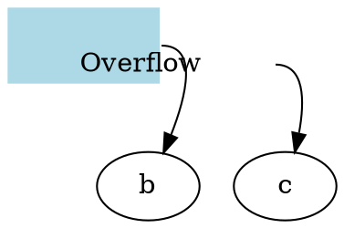

# DOT structural authoring

The native DOT canvas can edit individual edges from chains, endpoint products,
and repeated declarations in strict graphs. It also exposes record-field and
HTML-table structure in the property inspector.

## Source transactions

All operations start from a `DotObjectEdit` or `DotLabelEdit` captured from the
current document. A successful operation creates one source edit and one undo
entry. Callers must reopen selections after changing the document. Failed
operations leave the source and undo history unchanged.

`OpenDotObject` consumes the native renderer's `DotSourceLocation`. Shared edge
metadata is verified against the parser's logical edge, its last contributing
statement and arrow, its endpoints, and its strict-merge state. It is not enough
to supply an arbitrary matching source range.

Shared edge edits expand contributing statements into independent edge
statements. Endpoint node declarations and subgraph bodies stay where they were;
comments stay once at their original positions. Explicit edge attributes follow
each expanded contribution so inherited defaults and strict-edge overrides keep
their evaluation order. The transaction reparses the result and compares node
attributes, memberships, logical edges, ports, and edge attributes before saving.

The following operations automatically normalize the required statements:

- `RenameDotObject(edge, text)` changes the selected edge's display label.
- `RetargetDot(edge, node, from)` moves the selected endpoint on every contributing
  declaration. Retargeting cannot create a strict-edge collision or silently add
  a node to a contributing subgraph.
- `RemoveDotEdge(edge)` removes every contribution to the selected logical edge
  while retaining the remaining chain/product connections.
- `NormalizeDotEdge(edge)` explicitly expands a shared statement without changing
  graph semantics. It returns `false` if all contributions are already independent
  statements, including repeated singleton declarations in a strict graph.

## Record fields

`OpenDotLabel(item)` returns a structured snapshot for record/Mrecord nodes and
HTML-table labels on nodes or edges. `CreateDotRecordLabel(node, text)` and
`CreateDotTableLabel(item, rows, columns)` initialize a label on a selected node
or edge. Record fields apply to nodes; edge table edits isolate the selected
logical edge even when the label originated in a shared/default declaration.

Record fields have stable paths within the snapshot, such as `"0"`, `"1"`, and
`"1.0"`. An empty parent path addresses the outer record. Paths are positional and
must be read again after an insertion, move, grouping, or removal.

| API | Meaning |
| --- | --- |
| `InsertDotRecordField(label, parentPath, index, text, port)` | Insert a sibling at a zero-based position. |
| `RemoveDotRecordField(label, path)` | Remove a field or group while retaining at least one sibling. |
| `MoveDotRecordField(label, path, index)` | Reorder a field within its current parent. |
| `GroupDotRecordFields(label, parentPath, index, count)` | Wrap consecutive siblings in a nested record group. |
| `UngroupDotRecordField(label, path)` | Remove a group's braces and retain its children. |
| `SetDotRecordFieldText(label, path, text)` | Replace a leaf's text with record-grammar escaping. |
| `SetDotRecordFieldPort(label, path, port)` | Set, rename, or clear a leaf port. |

A structured snapshot reports each field's parent, sibling index, group state,
text, port, and source span. Spans address the current page source, not the whole
multi-page document. Concatenated quoted strings and escaped characters are
mapped back to their original source positions.

## HTML tables

Tables are indexed in source order, including nested tables. Row and column
coordinates are zero-based grid positions. A cell selection uses the origin of a
cell, not a position covered by its row or column span.

| API | Meaning |
| --- | --- |
| `SetDotTableCellText(label, table, row, column, text)` | Replace cell content, escaping HTML and representing newlines with `BR`. |
| `SetDotTableCellPort(label, table, row, column, port)` | Set, rename, or clear the cell port. |
| `InsertDotTableRow(label, table, index)` | Insert a row; expand crossing row spans. |
| `RemoveDotTableRow(label, table, index)` | Remove a row; contract spans and move surviving spanning cells into the next row. |
| `InsertDotTableColumn(label, table, index)` | Insert a grid column; expand crossing column spans. |
| `RemoveDotTableColumn(label, table, index)` | Remove a column; contract spans or remove unspanned cells. |
| `InsertDotTableCell(label, table, row, index, text, port)` | Insert a direct cell at its ordinal position within a row. |
| `RemoveDotTableCell(label, table, row, column)` | Remove a cell by its grid origin. |
| `MergeDotTableCells(label, table, row, column, rows, columns)` | Merge whole cells covering the requested rectangle. |
| `SplitDotTableCell(label, table, row, column)` | Split a spanning cell into unit cells. |

Row, column, merge, and split operations require a rectangular grid. Individual
cell insertion and removal can author ragged tables. Operations retain unrelated
tags, attributes, quote choices, and comments. A merge retains the upper-left
cell's attributes and port and joins text content with line breaks. Table/image
cells have different HTML grammar productions and cannot be merged with other
content. Split retains the original contents and port in the upper-left cell.

### Table rules

The native renderer accepts `HR` between table rows and `VR` between cells in a
row, including their empty paired forms. Tag names remain case-insensitive.
`ROWS="*"` and `COLUMNS="*"` add the corresponding rules throughout a table;
`*` is the only supported value. Explicit and uniform rules combine without
duplicate paint. Rules use the table color and a one-point pen. They follow the
actual cell grid: a horizontal rule does not cross a cell whose row span extends
past the boundary, and a vertical rule does not divide a column span. These
productions and attribute meanings follow the
[Graphviz HTML-label grammar](https://graphviz.org/doc/info/shapes.html#html).

Rules keep their own source spans and do not count as rows or cells in the
structured selection. Existing rule markup stays verbatim during insertion and
text/port edits. Insertion before a row or cell leaves any preceding rule before
the new item. Deletion coalesces the gaps between surviving siblings, retaining
the first rule in each surviving gap and removing orphaned leading/trailing
rules. A merge removes rules internal to the merged cells and retains the
surviving outside boundary. A split keeps the original outside rule; uniform
`ROWS`/`COLUMNS` attributes also apply to the newly created boundaries. When a
surviving row-span cell moves into the next row, its following vertical rule and
adjacent trivia move with it. Comments outside removed rows/cells, and comments
inside a removed paired rule, remain unchanged.

Misplaced, repeated, or trailing rules, nonempty rule contents, rule attributes,
and invalid `ROWS`/`COLUMNS` values are rejected by the native path. All structural
operations keep the same stale-snapshot, port-integrity, and atomic undo guards
as tables without rules.

### Fixed dimensions and nested tables

The native renderer supports `FIXEDSIZE="TRUE"` on both `TABLE` and `TD`. Widths
and heights are point dimensions including borders and padding, independent of
the graph's inch-valued node `width` and `height` attributes.

* A fixed table with positive `WIDTH` and `HEIGHT` retains that frame size even
  when its rows and cells extend beyond the frame. Text and overflowing cell
  geometry remain visible; there is no implicit clip or text scaling. The SVG
  bounds include the rendered overflow.
* A fixed cell supplies its specified dimensions to the grid. A cell sharing a
  wider column or taller row can still receive that larger grid slot, following
  the bundled Graphviz 14.1.1 behavior. Its text never expands the grid merely
  because the text is too large for its requested fixed dimensions.
* A fixed request with an omitted or zero dimension uses normal minimum sizing.
  It does not create an artificial one-point cell. Negative, nonfinite and
  excessive dimensions are rejected.
* A table's minimum `WIDTH`/`HEIGHT` can reserve unused space after its natural
  grid. Only extra allocation from a containing cell expands the grid's rows
  and columns. A nonfixed nested table fills the cell's available interior.
* A nested fixed table uses its own `ALIGN` and `VALIGN` to position its declared
  rectangle. The containing cell's text alignment does not reposition it.
  Every alignment retains the declared fixed table dimensions.
* Cell content is inset by both `BORDER` and `CELLPADDING`. Empty cells do not
  receive a phantom text line; an explicit `BR` still contributes a line.
  Thick borders are painted inside the allocated rectangle.
* Table ports use the table's final rectangle. Cell ports use the final cell
  slot, including any natural grid overflow and nested-table translation.
  These rules apply to node labels and connector labels alike.
* `STYLE="INVIS"` suppresses a cell or table's paint and descendants while
  preserving its grid allocation and ports. Table `ROUNDED` and invisibility
  styles can be combined with comma or whitespace separators.

For example, this table has an 80-by-40 frame with a 140-by-60 cell extending
beyond it. The two ports intentionally refer to different rectangles:

Node `fixedsize=true` now reserves the shape size during graph placement, while
`fixedsize=shape` additionally reserves the label's space. Both retain the
specified shape dimensions and route ordinary edges to the shape boundary.
The final SVG includes visible overflowing labels in either mode. These
semantics follow the [Graphviz node sizing contract](https://graphviz.org/docs/attrs/fixedsize/).
Native font metrics and integer placement remain distinct from Graphviz's
pixel-level layout.

The parser bounds labels to 65,536 characters, 32 nested levels, 1,024 record
fields or table cells, and 128 grid rows/columns. Operations reject an empty table
row, a span outside the declared rows, overlapping spans, duplicate ports, or an
invalid resulting label.

## Port integrity

Renaming a port updates source endpoint references, including quoted ports and
earlier declarations of strict edges. Explicit `headport`/`tailport` references
are updated, and inherited edge attributes receive local overrides where needed.
Shared node labels receive node-local overrides, so changing one node does not
rename other nodes' ports or rewrite scoped defaults.

Removing a field, cell, row, column, or label is rejected if it would remove a
referenced port. This includes references in earlier strict-edge declarations
that are overridden in the final rendered edge. A surviving rowspan cell moves
with its content and port when its originating row is removed.

## Canvas integration

Native DOT groups expose `data-canvas-id` equal to their `data-dot-id`. Node and
cluster groups expose `data-canvas-parent` for their direct owning cluster,
skipping non-cluster scopes. Late node membership uses the cluster selected by
the native layout rather than the node's first declaration.

DOT edge IDs contain renderer ordinals, so structural edits remap persisted
connector geometry by source provenance. Surviving arrows retain their original
logical edge; normalized chain/product statements carry that edge's provenance
into each generated declaration. This preserves the correct occurrence when
parallel edges are deleted or reordered, including nested subgraphs and strict
merged declarations. Deleted or stale DOT edge records are removed. Reattaching
an endpoint discards the previous route for that connection, matching the
canvas's existing endpoint-identity guard. Source and metadata changes share one
undo/redo transaction; untouched nodes retain their saved geometry.

`MainPage` integrates structure controls through `AddDotStructureActions(item)`
and `AddDotFieldStructureActions(literal)`. Clicking a rendered record field or
HTML-table text selects the corresponding field/cell in the inspector, including
the innermost containing table.

## Native output size and padding

The native DOT renderer accepts scalar or two-axis graph padding, such as
`pad=.25` or `pad=".5,1"`, measured in inches. Padding extends the painted
background around the drawing and leaves object coordinates unchanged, following
Graphviz's [pad contract](https://graphviz.org/docs/attrs/pad/).

Graph `size` accepts a scalar or a width/height pair, such as `size=4` or
`size="6,3"`. The finished drawing, including padding, is uniformly reduced to
fit those bounds when necessary. A trailing `!`, as in `size="6,3!"`, also permits
enlargement until one requested dimension is reached. A zero dimension disables
size fitting. These are output bounds; they do not change node ranks or stretch
node shapes. The SVG viewBox and source-selection geometry remain unchanged.
See Graphviz's [size contract](https://graphviz.org/docs/attrs/size/).

Both attributes accept finite values from 0 through 200 inches. Malformed values
and sizes below the renderer's output precision use the compatibility renderer.
`ratio`, page tiling, viewport cropping, rotation, and non-`dot` engines still
require the reference engine. Native output sizing does not imply Graphviz
placement equivalence.
